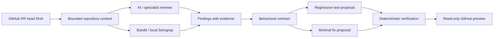

# RepoPilot

[](https://github.com/Dahlia00/repopilot/actions/workflows/ci.yml)

A repository-aware GitHub pull request review tool combining AI observations, static security analysis, behavioral contracts, generated regression tests, and deterministic fix verification. Proposed changes stay separate from approval. **GitHub writes are disabled by default.**

## Demo

Run locally, open <http://localhost:3000>, and fetch `Dahlia00/repopilot`, PR `1`. Choose **Analyze with AI**, or **Run Agent Review** for bounded specialist reviews. Inspect context, scanner evidence, proposed tests/fixes, verification, and GitHub previews. The intentionally unsafe sample is a demonstration, not an application dependency.

An empty-list issue does not establish whether the API should return a sentinel or raise an exception. When repository evidence cannot resolve that question, RepoPilot marks the contract ambiguous and refuses automatic approval. A failed/skipped verification is an honest result.

## Why RepoPilot

A plausible AI suggestion is insufficient evidence that a change is correct. RepoPilot separates observations, desired behavior, proposals, and verification. It preserves scanner/agent provenance and requires a regression test to fail before a fix and pass afterward before marking a proposal safe to apply.

## Features

- Public GitHub PR metadata, paginated changed files, patches, and immutable head snapshots.
- Bounded repository context: README, directly imported local files, and justified nearby module files.
- Structured repository-aware AI findings and bounded Bug, Security, and Performance specialist reviews.
- Bandit and optional Semgrep with committed local rules; normalized findings and conservative deduplication.
- Evidence-grounded behavioral contracts; minimal pytest proposals and local function-level fix proposals.
- Deterministic verification independent of OpenAI: syntax, restricted AST, compatibility, before/after pytest and scanners.
- Read-only GitHub previews. Backend write operations remain separately gated; no frontend publish/apply action.
- Structured metadata logs, request IDs/timing, health checks, container definitions, and deterministic CI.
- A reproducible, scan-only synthetic benchmark with measured source-specific results.

## Architecture



Responsibilities are separate backend modules: `github`, `context`, `review`, `static_analysis`, `pipeline`, `contracts`, `test_generation`, `fix_generation`, `verification`, `agents`, and `github_actions`. `api_models` owns request schemas; `main` orchestrates routes; `config` owns non-secret settings; `observability` logs allowlisted metadata.

`/api/v1` aliases share the existing handlers/models. Original paths remain compatible. Main endpoints:

| Endpoint | Purpose |
|---|---|
| `GET /health` | API readiness |
| `POST /analyze` | Read real PR metadata/files |
| `POST /review` | Context-aware AI + static findings |
| `POST /generate-tests` | Desired-behavior regression proposals |
| `POST /generate-fixes` | Minimal fix proposals; reuse supplied test artifacts |
| `POST /verify-fix` | Deterministic verification of supplied artifacts; zero OpenAI calls |
| `POST /verify-fixes` | Legacy orchestration, including AI generation |
| `POST /agent-review` | Bounded coordinated specialist pipeline |
| `POST /github/preview-review` | Dry-run review payload |
| `POST /github/preview-fix-pr` | Dry-run verified fix/draft-PR plan |

All POST retrieval/review actions use `{ "repository": "owner/repo", "pull_request": 1 }`. Direct verification additionally requires the immutable `head_sha`, `finding`, `validated_fix`, and optional `validated_test`. The UI submits existing artifacts. Stale or mismatched artifacts are rejected. Preview routes use an agent `review_id` and optional `finding_id`. Sessions expire after ten minutes and disappear on restart.

## Safety Design

- Read-only default. Preview routes never write. Separate write routes require **both** `GITHUB_WRITE_ENABLED=true` and explicit `confirm_write=true`. Compose and CI force writes off. No merge operation exists.
- Desired behavior must be supported by quoted repository documentation or existing tests and high confidence. Inference alone is ambiguous. Test and fix stages share the same unchanged contract; verification never rewrites tests to accommodate a fix.
- Python AST syntax validation and explicit execution allowlists reject process/shell execution, dynamic code, reflection, unsafe imports, filesystem mutation and network calls. Fixes are small exact replacements and preserve function signatures.
- Verification uses disposable `tempfile` workspaces containing only bounded necessary files. An OS sandbox denies network and outside writes. Reviewed source is never executed in the real repository.
- **Execution currently requires macOS `sandbox-exec`. Linux/Docker verification skips, rather than falling back to unrestricted execution.** No Docker execution sandbox is implemented.
- Trusted pytest, Bandit and Semgrep invocations use fixed commands, sanitized environments, timeouts, bounded output and process cleanup. Generated shell commands are never run.
- `safe_to_apply=true` requires an unambiguous compatible contract, valid syntax, safe test/source, a genuine before-fix test failure followed by after-fix success, successful required scans, and no new severe scanner findings. Syntax alone never approves a fix.
- Limits: up to 20 changed files; 8 context files; 24 KB/file; 80,000 context characters. Scanner timeout 15s, capped input/output. Verification up to 5 fixes/tests, 32 workspace files, 256 KB workspace, 10s test wall time and OS resource limits. AI input/output budgets are bounded per stage.
- Logs contain event names, counts, status, route templates and duration; not patches, environment dumps, credentials or exception text. Third-party HTTP debug logging is suppressed. Request errors omit echoed input; unexpected errors return a generic 500.

These gates reduce risk; they do not establish a general-purpose secure sandbox or prove arbitrary code correct.

## Tech Stack

Python 3.10+, FastAPI, Pydantic, httpx, official OpenAI Python SDK, pytest, Bandit, optional Semgrep; Next.js App Router, TypeScript, React; Docker Compose and GitHub Actions. No database.

## Local Setup

Use Python 3.10+ and Node.js 22. From this repository root, in terminal 1:

```sh
cd backend
python3 -m venv .venv
source .venv/bin/activate
python -m pip install -r requirements.txt
export GITHUB_WRITE_ENABLED=false
export OPENAI_MODEL=gpt-4.1-mini-2025-04-14
read -s 'OPENAI_API_KEY?OpenAI API key: '; echo
export OPENAI_API_KEY
uvicorn main:app --reload --host 127.0.0.1 --port 8000 --no-access-log
```

The hidden-input command is for macOS zsh. Bash equivalent: `read -s -p 'OpenAI API key: ' OPENAI_API_KEY; echo; export OPENAI_API_KEY`. Enter the key locally; never paste it into source or documentation. AI is optional for fetching PRs and deterministic artifact verification.

Terminal 2, from the repository root:

```sh
cd frontend
npm ci
npm run dev -- --hostname 127.0.0.1
```

Open <http://localhost:3000>; API docs: <http://127.0.0.1:8000/docs>. Public repository reads need no GitHub token.

### Optional Semgrep installation

Use a separate environment to avoid Semgrep/OpenTelemetry dependency conflicts with FastAPI:

```sh
python3 -m venv /tmp/repopilot-semgrep
/tmp/repopilot-semgrep/bin/python -m pip install semgrep==1.180.0
export PATH="/tmp/repopilot-semgrep/bin:$PATH"
```

Export this PATH before starting the backend or benchmark. Missing Semgrep is reported as unavailable; Bandit is included in backend requirements. Rules are local `backend/semgrep-rules.yml`; no remote rule registry or automatic fixes.

## Environment Variables

Copy `.env.example` to `.env` if useful. Values are placeholders. The backend reads **exported environment variables**, not dotenv files automatically. Compose reads `.env` for interpolation; keep it local and ignored. Never put credentials in `NEXT_PUBLIC_*` variables.

| Variable | Default / purpose |
|---|---|
| `OPENAI_API_KEY` | Empty; required only by AI generation/review |
| `GITHUB_TOKEN` | Empty; optional authenticated reads/higher GitHub limits |
| `GITHUB_WRITE_ENABLED` | `false`; independent backend write gate |
| `OPENAI_MODEL` | `gpt-4.1-mini-2025-04-14`; model must support structured output |
| `ALLOWED_ORIGINS` | `http://localhost:3000,http://127.0.0.1:3000`; comma-separated explicit origins |
| `LOG_LEVEL` | `INFO`; structured application logging level |
| `NEXT_PUBLIC_API_URL` | `http://localhost:8000`; frontend browser API URL, baked at build time |

`.env`, `.env.*` except `.env.example`, keys, PEM files and `secrets/` are ignored. Existing caches are process-local; use one backend worker.

## Running Tests

From the root, without an API key:

```sh
LOG_LEVEL=ERROR backend/.venv/bin/python -m unittest discover -s backend -p 'test_*.py'
backend/.venv/bin/python -m compileall -q backend
backend/.venv/bin/python scripts/check_security.py
cd frontend
npm run lint
npm run build
npm run typecheck
```

Build precedes typecheck so generated Next route types exist in a clean checkout. Tests mock external APIs; sandbox/scanner tests use deterministic synthetic data. Sandbox-dependent tests skip on unsupported or restricted environments. The macOS CI job exercises the supported sandbox. Bandit’s production check excludes unit fixtures, **not** the `test_generation.py` service, and gates medium/high severity findings. Optional local Semgrep check:

```sh
semgrep scan --config backend/semgrep-rules.yml --metrics off --disable-version-check --error backend
```

## Running Benchmark

```sh
source backend/.venv/bin/activate
python benchmark/run_benchmark.py
# Optional real paid AI run; requires exported OPENAI_API_KEY:
python benchmark/run_benchmark.py --ai
```

Both commands produce `benchmark/results.json` and `benchmark/RESULTS.md`; optional AI mode replaces the previous results. Preserve a copy first if comparing runs. AI failures do not substitute mock results. Twelve labeled Python/JS/TS fixtures cover security, bugs, performance and safe examples. Fixtures are **never executed**.

Scoring matches expected category and exact source line; severity remains available for inspection. Multiple observations at the same category/location collapse. Additional observations count as false positives; unsupported/error cases remain misses. Per-source scores, raw findings, scanner status, findings/case, versions and average latency are recorded. AI is explicitly `not_run` in static-only results. [Measured results](benchmark/RESULTS.md) are generated from actual outputs. This small synthetic suite does not measure real-world correctness or repository-wide recall.

## Docker

```sh
docker compose config --quiet
docker compose build
docker compose up -d --wait
curl http://127.0.0.1:8000/health
curl http://127.0.0.1:3000/api/health
docker compose down
```

Credentials are injected externally; Compose forces `GITHUB_WRITE_ENABLED=false`. Ports bind localhost. Both images use non-root users and health checks; Next.js uses standalone production output. Backend runs one worker. Docker Desktop must be running. Semgrep is optional and not bundled in the backend image; install it separately if customizing the image. Linux execution verification remains **SKIPPED**, while retrieval, review, scans and proposal generation are available. No public deployment is configured.

## CI/CD

[`.github/workflows/ci.yml`](.github/workflows/ci.yml) runs on pull requests and pushes to `main`, with repository read-only permissions and no credentials. It runs macOS backend tests/compilation/Bandit/benchmark, Ubuntu frontend install/lint/build/types, and a separate isolated Semgrep job using only local rules. No deployment or GitHub write step is included. The badge reflects actual GitHub run status; local validation alone does not imply hosted CI has run.

## Project Structure

```text
backend/             API, bounded services, safety gates and offline tests
frontend/app/        Dashboard, evidence views, pipeline overview, health route
benchmark/cases/     Labeled synthetic scan-only fixtures
benchmark/           Dataset, runner, actual JSON and Markdown results
scripts/             Production security check
.github/workflows/   CI validation
.env.example         Non-secret configuration template
docker-compose.yml   Local read-only demo containers
PORTFOLIO.md         Verified facts, measured metrics and resume bullets
```

## Current Limitations

- No authentication, database, durable sessions, distributed jobs or public deployment hardening. This is a local portfolio demonstrator, not an internet-facing production service.
- macOS-only execution sandbox; verification skips on Linux and Docker. AST constraints intentionally reject many normal but unsupported programs.
- Small local scanner rules and Python-focused generated tests/fixes. Static scanners miss many semantic/performance issues. Benchmark results quantify this limitation.
- AI is paid, nondeterministic and may fail or exceed bounded upstream budgets. Agent review is expensive; direct verification is independent of AI.
- Context selection is bounded and deterministic, not a complete dependency graph. Large/generated/binary files may be skipped.
- A correct intended behavior often cannot be established automatically. Such findings stay ambiguous and unapproved.
- Before/after tests and scanners provide evidence, not proof of freedom from regressions. No complete project test suite is downloaded/executed.
- GitHub write paths have offline mocked tests; this milestone does not perform real writes. Preview IDs expire and must be regenerated after restart.

## Future Work

A properly validated Linux execution sandbox, wider contract evidence and language support, larger independently labeled benchmarks, durable jobs and explicit deployment authentication/rate controls. Any future writes must preserve human confirmation and verification gates.

## Screenshots / Demo

Run the local demo above to inspect the pipeline and evidence panels. No screenshot or recorded deployment is claimed. [PORTFOLIO.md](PORTFOLIO.md) contains measured engineering facts and suggested resume language.
